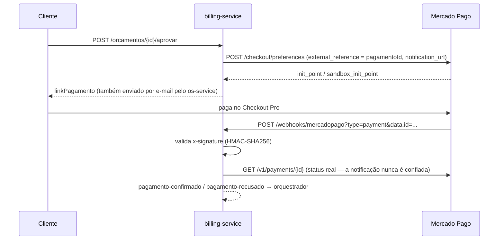

# billing-service — Orçamento e Pagamento

Microsserviço responsável pela **geração e aprovação de orçamentos**, pela **cobrança via Mercado Pago**
(Checkout Pro + webhook) e pelos **estornos** — participante da Saga orquestrada pelo
[os-service](../fiap-tc4-os-service) (veja lá a arquitetura geral e a justificativa da orquestração).

| | |
|---|---|
| Banco | **PostgreSQL** próprio (`billing_db`) — dados financeiros exigem ACID, unicidade (1 orçamento por OS) e lock otimista |
| Mensageria | consome `billing-service.comandos` (`billing.*`), publica eventos em `oficina.saga.eventos` |
| Integração externa | API do Mercado Pago (`/checkout/preferences`, `/v1/payments/{id}`, `/v1/payments/{id}/refunds`) |

## Papel na Saga

| Comando recebido | Ação | Evento publicado |
|---|---|---|
| `billing.gerar-orcamento` | Cria o orçamento com os itens/preços do diagnóstico (idempotente por OS) | `billing.orcamento-gerado` |
| `billing.cancelar-orcamento` | **Compensação**: cancela orçamento pendente/aprovado (pago → aguarda estorno) | `billing.orcamento-cancelado` |
| `billing.estornar-pagamento` | **Compensação**: estorno total no Mercado Pago (`X-Idempotency-Key`) | `billing.pagamento-estornado` |

| Ação do cliente / provedor | Evento publicado |
|---|---|
| `POST /orcamentos/{id}/aprovar` → cria preferência no Mercado Pago e devolve o link | `billing.orcamento-aprovado` (com `linkPagamento`) |
| `POST /orcamentos/{id}/rejeitar` | `billing.orcamento-rejeitado` |
| Webhook `payment` aprovado | `billing.pagamento-confirmado` |
| Webhook `payment` recusado/cancelado | `billing.pagamento-recusado` |

## Integração com o Mercado Pago



- **Segurança do webhook**: assinatura `x-signature` validada com a *assinatura secreta* do painel
  (`id:{data.id};request-id:{x-request-id};ts:{ts};`, HMAC-SHA256). Sem secret configurado a validação é desligada.
- **Idempotência**: o Mercado Pago reenvia notificações; pagamento já em estado final é ignorado. Estornos usam
  `X-Idempotency-Key = estorno-{pagamentoId}`.
- **Modos** (`MERCADOPAGO_MODO`):
  - `mercadopago` — API real. Configure `MERCADOPAGO_ACCESS_TOKEN` (credenciais de teste do
    [painel de desenvolvedor](https://www.mercadopago.com.br/developers/panel/app)), `MERCADOPAGO_WEBHOOK_SECRET`
    e `MERCADOPAGO_NOTIFICATION_URL` (URL pública: ALB do EKS ou túnel local, ex. ngrok). Token `TEST-...` usa o
    `sandbox_init_point`.
  - `fake` (padrão em dev/CI) — o link aponta para `/pagamentos/{id}/checkout-simulado`, página que permite
    aprovar/recusar e percorre **o mesmo caminho do webhook real**.

## API

Swagger: `http://localhost:8081/swagger-ui.html`. Token de **CLIENTE** (Lambda de CPF) só acessa o próprio
orçamento (CPF do token = CPF do orçamento); **ADMIN** acessa todos.

| Método | Rota | Acesso |
|---|---|---|
| GET | `/orcamentos/{id}`, `/orcamentos/os/{osId}`, `/orcamentos/{id}/pagamentos` | ADMIN, CLIENTE dono |
| POST | `/orcamentos/{id}/aprovar`, `/orcamentos/{id}/rejeitar` | ADMIN, CLIENTE dono |
| POST | `/webhooks/mercadopago` | público (assinatura) |
| GET/POST | `/pagamentos/{id}/checkout-simulado`, `/pagamentos/{id}/simular` | público, só no modo `fake` |

## Executando e testando

```bash
cp .env.example .env && docker compose up --build      # serviço isolado (porta 8081)
./mvnw verify                                           # unitários + BDD + integração + JaCoCo ≥ 80%
```

Sistema completo e teste ponta a ponta: `docker-compose.full.yml` e `scripts/e2e-saga.sh` no os-service.

- **BDD**: [`features/pagamento_orcamento.feature`](src/test/resources/features/pagamento_orcamento.feature)
  (aprovação + pagamento, recusa, estorno como compensação, rejeição + cancelamento).
- **Integração com o Mercado Pago testada** contra servidor HTTP simulado (`MockRestServiceServer`): payload da
  preferência, sandbox × produção, consulta, estorno com idempotência e tratamento de erros.
- **Cobertura**: 95% de linhas.

<!-- Evidências: substituir pelos prints do pipeline / relatório JaCoCo / SonarQube -->

## CI/CD e Kubernetes

Mesma pipeline dos demais serviços (`build-test` → `quality` (SonarQube) → `docker` → `deploy-kind` →
`deploy-eks`). No EKS, se `MERCADOPAGO_ACCESS_TOKEN` estiver configurado, o job muda o ConfigMap para o modo
`mercadopago` e aponta `MERCADOPAGO_NOTIFICATION_URL` para o ALB compartilhado.
Secrets: `BILLING_DB_PASSWORD`, `MERCADOPAGO_ACCESS_TOKEN`, `MERCADOPAGO_WEBHOOK_SECRET`, `JWT_SECRET`,
`RABBITMQ_PASSWORD` + credenciais AWS da sessão do Learner Lab.

`k8s/`: ConfigMap/Secret, **PostgreSQL próprio (StatefulSet)**, Deployment com probes do Actuator, HPA e Ingress
(`/orcamentos`, `/pagamentos`, `/webhooks`) no ALB compartilhado.
